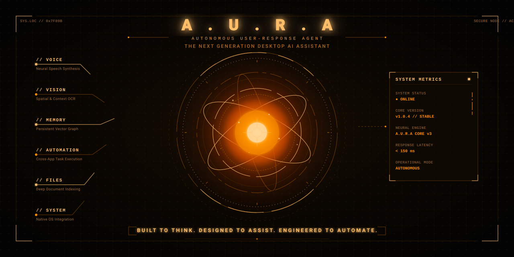

# A.U.R.A v2

### Autonomous User-Responsive Assistant



**A.U.R.A v2** is an AI-powered desktop assistant designed to make everyday computer interaction more natural, intelligent, and automated.

It combines AI conversation, real-time voice interaction, desktop automation, system controls, persistent memory, web research, file processing, wake-up commands, offline speech recognition, local AI models, configurable text-to-speech, agent capabilities, face unlock, room monitoring, and a modular plugin architecture into a single desktop assistant.

Built by **CodeCrafters**.

---

## Overview

A.U.R.A is designed to work alongside the user rather than functioning as a conventional chatbot.

It can understand natural-language commands, interact with the desktop, perform supported system actions, remember information, research topics, process files, operate supported browser workflows, and respond through voice.

A.U.R.A v2 also introduces a flexible AI architecture that allows users to choose between cloud-based Gemini Live and locally running AI systems.

### AI Modes

A.U.R.A supports three primary AI configurations:

| Mode | Description |
|---|---|
| **Gemini Key Only** | Uses Gemini as the primary AI system. |
| **Local AI Only** | Runs the AI pipeline locally without requiring a Gemini API key. |
| **Gemini + Local Fallback** | Uses Gemini as the primary system and switches to a local AI provider when Gemini becomes unavailable. |

The AI configuration can be selected during setup or changed later through:

**Customize → Local AI / STT / TTS Settings**

Existing Gemini configuration files remain compatible with the newer configuration system.

---

# Features

| Feature | Description |
|---|---|
| **AI Voice Interaction** | Natural voice-based communication with A.U.R.A. |
| **Gemini Live** | Real-time AI interaction using Gemini Live when configured. |
| **Local AI Mode** | Run AI conversations locally using supported local inference providers. |
| **Gemini + Local Fallback** | Automatically fall back to a local AI system when Gemini becomes unavailable. |
| **Offline Speech Recognition** | Local speech recognition powered by Vosk. |
| **Offline British JARVIS Voice** | Local Kokoro ONNX speech synthesis with the `bm_george` British voice. |
| **Multiple TTS Engines** | Supports Kokoro, Edge TTS, and ElevenLabs depending on configuration. |
| **Wake-Up System** | Activate A.U.R.A through configurable wake commands. |
| **"Hey AURA"** | Natural voice activation command. |
| **"AURA, Wake Up"** | Dedicated wake-up command inspired by traditional cinematic AI assistants. |
| **"Wake Up, Daddy's Home"** | Custom wake-up command for a Tony Stark / Iron Man-inspired experience. |
| **Desktop Automation** | Execute supported desktop, keyboard, mouse, browser, and system actions. |
| **System Control** | Control supported system functions and desktop operations. |
| **Persistent Memory** | Store and retrieve useful information across sessions. |
| **Hybrid Interaction** | Switch between voice and keyboard-based interaction. |
| **Custom Microphone** | Select the microphone used for voice input. |
| **Custom Speaker** | Select the speaker, headset, or other output device. |
| **Web Research** | Retrieve and process information through supported online capabilities. |
| **Browser Interaction** | Perform supported browser-based tasks and automation. |
| **File Processing** | Work with supported local files and processing workflows. |
| **Agent Mode** | Allow A.U.R.A to perform supported actions through its tool system. |
| **Plugin System** | Extend A.U.R.A through modular plugins. |
| **Face Unlock** | Optional camera-based facial recognition for authorization. |
| **Room Checking** | Monitor the room through the camera with a draggable preview window. |
| **Assistant Customization** | Configure AI, voice, audio devices, and assistant preferences. |
| **Modular Architecture** | Separates core logic, actions, memory, plugins, configuration, UI, and voice components. |
| **GOD'S EYE (Earth View)** | Advanced Earth View Feature which allows you to track air routes and inspect locations inside A.U.R.A itself |

---

# What's New in v2

A.U.R.A v2 significantly expands the original assistant architecture.

### AI & Local Intelligence

- Gemini Live remains the default cloud AI mode.
- Added **Local AI Only** mode.
- Added **Gemini + Local Fallback** mode.
- Added support for **Ollama**.
- Added support for **LM Studio** and OpenAI-compatible local endpoints.
- Added provider-aware model selection.
- Added local model status and availability detection.
- Added local agent/tool execution.
- Added configurable local model selection.
- Added local fallback when Gemini Live encounters connection or transport failures.

### Voice & Speech

- Added dedicated wake-up system.
- Added **"Hey AURA"** activation.
- Added **"AURA, Wake Up"** activation.
- Added **"DADDY's Home"** custom command.
- Added local Vosk speech recognition.
- Added offline Kokoro ONNX speech synthesis.
- Added British `bm_george` local voice.
- Added Edge TTS support.
- Added ElevenLabs support.
- Added configurable microphone selection.
- Added configurable speaker/output selection.
- Added continuous local microphone processing.
- Added configurable voice selection per TTS provider.
- Added selected-TTS support for Gemini spoken responses during fallback operation.

### Desktop & Security

- Expanded desktop automation.
- Added face unlock.
- Added room checking.
- Added confirmation gates for potentially sensitive agent actions.
- Added workspace restrictions for local agent tools.

### Architecture

- Added modular plugin architecture.
- Improved separation between core assistant components.
- Expanded customization capabilities.
- Improved local AI configuration and provider management.

---

# Local AI

A.U.R.A keeps **Gemini Live as the default AI system**, while providing local alternatives for users who want to run AI processing on their own computer.

Local AI can be configured through:

**Customize → Local AI / STT / TTS Settings**

The three available modes are:

### Gemini Key Only

Uses Gemini as the assistant's AI engine.

A valid Gemini API key is required.

### Local AI Only

Runs the AI pipeline locally.

This mode does not require a Gemini API key.

### Gemini + Local Fallback

Gemini remains the primary AI system.

If Gemini becomes unavailable because of a connection or Live transport failure, A.U.R.A can switch to the configured local provider.

---

# Supported Local AI Providers

## Ollama

A.U.R.A can communicate with locally running Ollama models.

Example models include:

```text
qwen2.5:1.5b
llama3.2:1b
qwen2.5:3b
llama3.2:3b
```

The default Ollama endpoint is:

```text
http://127.0.0.1:11434
```

A.U.R.A can query a reachable provider for available models, while models still need to be installed separately.

For low- to mid-range computers, smaller quantized models are recommended because they generally require less memory and can provide lower inference latency.

---

## LM Studio

A.U.R.A also supports LM Studio through its OpenAI-compatible local server.

The default endpoint is:

```text
http://127.0.0.1:1234/v1
```

The local model must be loaded in LM Studio and its server must be started before A.U.R.A can communicate with it.

---

# Offline Voice & Speech

A.U.R.A v2 provides a complete local voice pipeline.

The local voice architecture consists of:

```text
Microphone
    ↓
Vosk Speech Recognition
    ↓
Wake-Up / Voice Input
    ↓
Local AI Provider
    ↓
Agent / Action Processing
    ↓
Text Response
    ↓
Kokoro / Edge TTS / ElevenLabs
    ↓
Selected Speaker
```

## Speech Recognition

Local speech recognition uses **Vosk**.

A.U.R.A processes microphone audio continuously as it arrives rather than waiting to perform a second full pass over the entire utterance.

This reduces unnecessary processing and improves local responsiveness.

Vosk models are downloaded once and cached locally when required.

---

## Text-to-Speech

A.U.R.A supports multiple speech synthesis engines:

| TTS Engine | Type | Internet |
|---|---|---|
| **Kokoro** | Local / Offline | Not required |
| **Edge TTS** | Online | Required |
| **ElevenLabs** | Online | Required + API key |

### Kokoro

Kokoro provides the default CPU-friendly offline speech system.

The local British voice is:

```text
bm_george
```

Kokoro also provides multiple voice groups and languages through the voice selector.

The selected voice is remembered independently for each TTS engine.

---

# Gemini + Local TTS

When using:

**Gemini + Local Fallback**

A.U.R.A can keep Gemini as the responding AI while using the selected local or online TTS engine for spoken output.

The option:

**Use selected TTS voice for Gemini responses**

allows Gemini-generated responses to be spoken using the selected TTS provider.

If local-provider synthesis fails, A.U.R.A can fall back to Gemini-generated audio when available.

---

# Voice & Device Customization

A.U.R.A allows users to select individual audio devices.

### Microphone

The user can select which microphone A.U.R.A uses for voice input.

### Speaker

The user can select which speaker, headset, or other output device A.U.R.A uses for speech.

This makes A.U.R.A suitable for systems with multiple microphones, speakers, headsets, or virtual audio devices.

---

# Wake-Up System

A.U.R.A v2 introduces a dedicated wake-up system designed for hands-free interaction.

Supported commands include:

```text
Hey AURA
AURA, Wake Up
Wake Up, Daddy's Home
```

The wake-up pipeline is designed to allow A.U.R.A to remain available without requiring continuous manual interaction with the interface.

---

# Agent Mode

A.U.R.A includes an agent system capable of executing supported tools and workflows.

Agent tools operate within the configured workspace sandbox.

Potentially sensitive actions such as:

- File overwrites
- Application launching
- Other configured system actions

can require confirmation before execution.

To extend the agent, tools can be added as typed and documented functions within the agent tool system.

---

# Agent Tool Calling

For local providers, tool support depends on the capabilities reported by the selected model/provider.

Ollama capability information can be checked automatically.

LM Studio may not always expose capability metadata. If a loaded model supports tool calling but its endpoint does not report that capability, tool calling can be explicitly enabled through the configuration.

Example:

```yaml
agent:
  tool_calling: true
```

Using:

```yaml
agent:
  tool_calling: auto
```

allows A.U.R.A to disable agent actions when tool support cannot be confirmed.

---

# Plugin Architecture

The `plugins/` system allows A.U.R.A to be extended through independent modules.

Plugins can introduce additional:

```text
Automation capabilities
Integrations
Commands
Tools
Workflows
Assistant functions
```

This keeps optional functionality separate from the core assistant and provides a foundation for expanding the A.U.R.A ecosystem.

---

# Architecture

A.U.R.A v2 follows a modular Python architecture:

```text
A.U.R.A v2
│
├── actions/          # Desktop and system actions
├── config/           # Configuration and preferences
├── core/             # Core assistant and voice logic
├── dashboard/        # Dashboard components
|-- earth/            # Earth View Assets
├── memory/           # Persistent memory system
├── plugins/          # Plugin architecture
├── voices/           # Voice-related resources
│
├── aura/             # Local AI and agent components
│   └── agent/        # Local agent and tools
│
├── scripts/          # Setup and model utilities
├── tests/            # Focused application tests
│
├── main.py           # Application entry point
├── ui.py             # User interface
├── setup.py          # Setup configuration
├── config.yaml       # Runtime configuration
├── requirements.txt  # Python dependencies
└── .gitignore
```

This structure allows individual systems to be developed and maintained independently while keeping the main assistant modular and extensible.

---

# Voice Pipeline

The complete voice architecture can be represented as:

```text
                    ┌─────────────────┐
                    │   Microphone    │
                    └────────┬────────┘
                             │
                             ▼
                    ┌─────────────────┐
                    │ Wake Detection  │
                    └────────┬────────┘
                             │
                             ▼
                    ┌─────────────────┐
                    │ Voice / Vosk    │
                    │ Recognition     │
                    └────────┬────────┘
                             │
                             ▼
                 ┌─────────────────────────┐
                 │      AI Processing      │
                 │                         │
                 │ Gemini / Ollama /       │
                 │ LM Studio               │
                 └────────────┬────────────┘
                              │
                              ▼
                    ┌─────────────────┐
                    │ Agent / Actions │
                    └────────┬────────┘
                             │
                             ▼
                    ┌─────────────────┐
                    │ Text Response   │
                    └────────┬────────┘
                             │
                             ▼
                 ┌─────────────────────────┐
                 │       TTS Engine        │
                 │                         │
                 │ Kokoro / Edge /         │
                 │ ElevenLabs              │
                 └────────────┬────────────┘
                              │
                              ▼
                    ┌─────────────────┐
                    │ Selected Output │
                    │    Speaker      │
                    └─────────────────┘
```

---

# Installation

## 1. Clone the repository

```bash
git clone https://github.com/gitsdp-dev/A.U.R.A_v2-CodeCrafters.git
cd A.U.R.A_v2-CodeCrafters
```

## 2. Install dependencies

```bash
pip install -r requirements.txt
```

For the full local voice setup, the project setup script can install dependencies and download the required Vosk and Kokoro ONNX models:

```powershell
python setup.py
```

Alternatively, download the required models manually:

```powershell
python scripts\download_models.py
```

---

# Running A.U.R.A

Just start the program by typing:

```bash
python main.py
```

# Configuration

Runtime configuration is primarily controlled through:

```text
config.yaml
```

This includes settings related to:

- AI provider
- Local model
- Audio device
- Voice settings
- Model paths
- Wake word
- Workspace sandbox
- Agent limits
- Tool calling

The application also maintains its AI/API configuration separately.

Existing Gemini configuration files remain compatible with the newer setup flow.

---

# Requirements

| Requirement | Details |
|---|---|
| **Operating System** | Windows recommended; macOS and Linux may be supported |
| **Python** | Python 3.10–3.12 recommended for the complete local voice stack |
| **Internet** | Required for Gemini, web research, Edge TTS, ElevenLabs, and other online features |
| **Microphone** | Recommended for voice interaction |
| **Speaker / Headset** | Recommended for voice output |
| **Gemini API Key** | Required for Gemini Key Only and Gemini + Local Fallback |
| **Ollama** | Required when using Ollama local AI |
| **LM Studio** | Required when using LM Studio local AI |
| **Local AI Model** | Required for Local AI Only and local fallback |
| **Vosk Model** | Required for local speech recognition |
| **Kokoro Model** | Required for offline Kokoro speech synthesis |

> **Note:** The offline voice system can operate locally, but features that depend on Gemini, web research, online TTS providers, or other external services still require an internet connection.

---

# Recommended Local Configuration

For low- to mid-range computers, A.U.R.A recommends starting with:

```text
1B–3B quantized instruct model
Lightweight Vosk model
Kokoro local TTS
Concise spoken responses
```

Local generation is intentionally constrained to reduce latency and resource usage.

However, local response speed depends on:

- CPU performance
- Model size
- Model quantization
- Prompt size
- Tool usage
- Conversation history
- Cold-start time
- Speech-processing workload

Therefore, response times can vary significantly between systems.

---

# Known Limitations

Local AI mode currently has several differences from Gemini Live:

- Local mode uses endpointed speech recognition and text generation.
- It does not provide Gemini Live's native audio turn-taking.
- Proactive audio behavior available through Gemini Live is not provided by local models.
- CPU inference and local speech generation can be slower than Gemini Live.
- Vision is currently disabled for local models in this build.
- Gemini remains available for screen and camera understanding.
- Local tool calls are dispatched through A.U.R.A's existing tool executor and confirmation system.

# Notifications

A.U.R.A. can collect application notifications published through its local
notification bus and, where permitted, desktop notifications. New items appear
as in-window toasts below the draggable weather widget; notification history
can be opened by saying **"AURA, show and read all notifications"** (or "show
me all notifications", "read my notifications", or "any new notifications").
Use **"stop"** or **"skip"** to interrupt an active local readout. Notifications
can also be enabled or disabled in the notification-center panel.

Notification text is stored in `memory/notifications.json`, scored and spoken
locally. It is not sent to Gemini or another online service. OTP and
verification-code text is withheld from speech by default; set
`read_sensitive_notifications` to `true` in `config/api_keys.json` to allow it.
The remaining settings in that file are `notifications_enabled`,
`toast_timeout_seconds` (4.0-5.0 seconds), `max_visible_toasts`,
`max_stored_notifications`, `app_priority_overrides`, and `blocked_apps`.
Blocked apps are not captured or displayed.

On Windows, A.U.R.A. first requests permission through WinRT
`UserNotificationListener`. Unpackaged Python applications are commonly denied
that permission; A.U.R.A. then attempts a read-only poll of the Windows
notification database. On Linux, notification capture uses the D-Bus
notification monitor and may be denied by the session bus policy. macOS system
notification capture is not currently supported and may require Full Disk
Access. Application notifications remain available on every platform.

Plugins can publish local notifications without depending on the UI:

```python
from core.notifications.bus import notify

notify("My plugin", "Task finished", "Your export is ready.", priority=60)
```

### Manual notification checks

- Trigger a Windows desktop notification and check that its in-window toast is
  aligned below the weather widget and fades after about 4.5 seconds.
- Hover over a toast to pause/reset its timer; verify **Close** and **Maximize**.
- Publish a notification with the plugin `notify()` helper and confirm it
  appears in the toast stack.
- Say **"AURA, show and read all notifications"** and check priority ordering.
- Say **"stop"** during readout and confirm the local voice stops.

---

# System Controls

The **System Controls** toolbar icon opens a local panel for volume and mute,
brightness, Wi-Fi, airplane-mode radio handling, energy saver, Live Captions,
Night light, accessibility features, and audio output devices. The UI shares
A.U.R.A.'s existing palette and uses worker threads for operating-system calls.
Every applied state is read back before A.U.R.A. reports success. Windows is
the primary supported platform; other platforms show unavailable controls
instead of pretending a change succeeded.

Voice commands include:

- "Open system settings", "open quick settings", "show system controls", and
  "close system settings".
- "Set volume to 50 percent", "volume 30", "mute", "unmute", and "increase
  volume by 10".
- "Set brightness to 50 percent", "brightness to minimum", and
  "increase/decrease brightness".
- "Turn Wi-Fi on/off", "list Wi-Fi networks", "connect to `<network>`",
  "disconnect Wi-Fi", and "which Wi-Fi am I connected to".
- "Turn airplane mode on/off", "turn energy saver on/off", and
  "turn live captions on/off".
- "Turn night light on/off", "set night light strength to 60 percent", and
  accessibility requests such as "enable narrator", "enable sticky keys",
  "enable high contrast", "enable mono audio", and "set text size to 150
  percent".
- "Switch audio output to `<device>`", "which speaker is being used", "what is
  the volume", and "is night light on".

Wi-Fi radio-off and airplane-mode-on requests require confirmation unless the
command includes "confirm" or "force"; the panel always asks before making
those changes. Wi-Fi passwords are entered only in the masked panel prompt,
are not logged or saved by A.U.R.A., and Windows stores the resulting profile.
System Controls does not require a paid service or cloud API. A.U.R.A.'s
optional Gemini and other third-party AI integrations remain subject to their
providers' terms and pricing; the Local AI configuration can be used without a
Gemini key.
Voice requests to change a system setting open A.U.R.A.'s System Controls
panel and use the same verified controls as its tiles and sliders. If Windows
denies an operation that can be retried with elevated permissions, A.U.R.A.
starts elevated and requests UAC approval at launch when needed. The desktop
shortcut and `python main.py` use the same startup check. If approval is
cancelled, the application exits without running.

Windows-specific notes:

- Wi-Fi state is read from the Windows Radio API or the hardware/software
  radio status reported by `netsh`. Radio toggling first tries the Windows
  Radio API, then the named WLAN adapter; if Windows denies that operation,
  the adapter command can be retried after per-operation UAC approval.
- Airplane mode is approximated by saving and changing radio states because
  Windows does not expose a public airplane-mode switch. The previous states
  are held for the current app session.
- Energy saver is configured through the current power plan's DC threshold.
  It is unavailable on desktops without a battery; actual behavior depends on
  the Windows build and power-plan policy.
- Night light reads and updates Windows' native per-user CloudStore settings,
  including its enabled state and intensity. Its registry format is
  undocumented and may vary by Windows build; A.U.R.A. reports unsupported or
  malformed formats instead of applying a display-only gamma-ramp imitation.
- Output-device switching uses Windows' undocumented `IPolicyConfig` COM
  interface. If that interface is unavailable or blocked, the switch is
  reported as failed.
- Brightness uses the installed display controller when available and falls
  back to Windows WMI for displays exposing the native brightness interface.
  Some desktops and external monitors do not expose adjustable brightness.
  Volume uses the Windows master audio endpoint.
- macOS and Linux controls are currently unavailable; the panel disables them
  with a platform-support message.

### Manual System Controls checklist

- Toggle Wi-Fi, airplane mode, energy saver, Live Captions, and Night light;
  compare each tile with the OS read-back. Confirm Wi-Fi-off and airplane-mode
  confirmations can be accepted or cancelled.
- Scan Wi-Fi networks; connect to a saved network and a new secured network;
  verify the SSID, disconnect, and forget a saved profile. Ensure passwords
  never appear in logs, notifications, or spoken responses.
- Toggle every accessibility control and text size; verify the matching
  Windows setting and try the More Settings links.
- Switch the default audio output, change volume/mute and brightness, and
  confirm displayed percentages match the OS afterwards.
- Test every voice example above, including numeric words, status questions,
  panel open/close, explicit confirmation, and verified spoken responses.
- Check the top-right close button on the main panel and each submenu, Escape
  behavior, keyboard focus, and panel placement within screen bounds near the
  toolbar without covering weather or notifications.
- Test denied/admin-only access, unsupported monitors, desktops without a
  battery, missing Live Captions, and non-Windows platforms; verify each
  failure remains visible and is never reported as success.

---

# Testing

Focused voice and agent checks can be run with:

```bash
python -m unittest tests.test_voice_agent
```

The Kokoro synthesis test runs when the required model files are available; otherwise, it reports a skip.

### Manual Test Checklist

1. Fresh setup with Gemini and an existing API key.
2. Fresh Local AI Only setup without a Gemini key.
3. Existing installation using an older `api_keys.json`.
4. Start and stop Ollama and verify provider/model refresh.
5. Start and stop LM Studio and verify provider status.
6. Switch between Ollama and LM Studio.
7. Verify Vosk recognition and local model responses.
8. Verify Kokoro, Edge TTS, and voice output.
9. Test Gemini + Local Fallback after making Gemini unavailable.
10. Restore Gemini and verify reconnection.
11. Verify missing STT/TTS packages are reported instead of crashing the application.
12. Test ElevenLabs voice configuration and voice refresh.
13. Test Edge TTS voice selection.
14. Test microphone and speaker selection.
15. Test wake-up commands.
16. Test agent confirmation behavior.

---

# Project Status

A.U.R.A v2 is actively under development.

The architecture and feature set may continue to evolve as new:

- AI providers
- Automation capabilities
- Plugins
- Voice systems
- Agent tools
- Security features
- Integrations

are introduced.

---

# Contributions

Contributions are welcome.

You can contribute through:

- Bug fixes
- New features
- Plugin development
- UI improvements
- Voice-system improvements
- Local AI integrations
- Automation capabilities
- Agent tools
- Documentation
- Testing
- Performance improvements

For major changes, opening an issue before implementation is recommended.

---

# CodeCrafters

A.U.R.A is developed by **CodeCrafters**, an independent development team focused on:

- AI assistants
- Productivity software
- Developer tools
- Automation
- Experimental desktop applications

### GitHub

https://github.com/gitsdp-dev

### Instagram

https://instagram.com/codecrafters._org

---

# License

This project is licensed under the **MIT License**.

See the `LICENSE` file for details.

---

# A.U.R.A

### Autonomous User-Responsive Assistant

## Your Desktop. Smarter Than Ever.

### Built by CodeCrafters.
